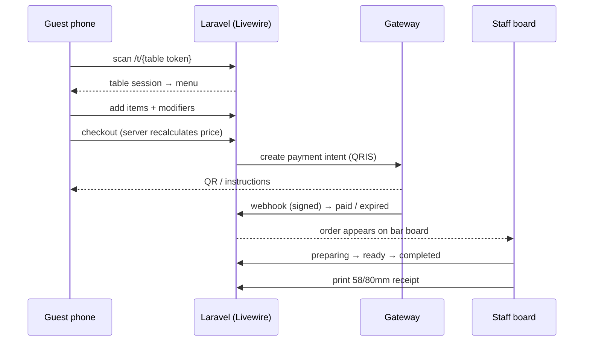

<p align="center">
  
  
  
  
  
  
  
</p>

<h1 align="center">QR Order &amp; QRIS Payment — Coffee Shop</h1>

<p align="center">
  Zero-install table ordering for a coffee shop: guests scan the QR on their table, order from their phone, and pay with Dynamic QRIS (Midtrans / Xendit) or a static merchant QRIS confirmed by the cashier. Staff get a cashier board, a bar station queue and 58/80&nbsp;mm thermal receipts.
</p>

---

## Why this exists

Small cafés lose time taking orders and matching payments by hand. This app moves the guest flow to a QR code on the table while keeping the staff in control: every order goes through a server-side pricing check and a strict state machine, and every payment is traceable (`payments` + `payment_events`) with signature-verified, idempotent webhooks.

## ✨ Features

| Area | What it does |
|---|---|
| **Table QR entry** | `/t/{token}` puts the table into the session; tokens can be regenerated (the old QR stops working) and printed straight from the admin panel. |
| **Guest ordering** | Menu with categories, product modifiers and availability, cart, checkout with per-item notes, and a shareable order-status page. |
| **Payments** | Pluggable gateways: **manual static QRIS** (cashier confirms settlement), **Midtrans**, **Xendit**. Payment intents, expiry (default 15 minutes), late payments flagged `needs_review`. |
| **Webhooks** | `/api/webhooks/payment/{gateway}` with signature verification and event-level idempotency via `payment_events` — a replayed callback never double-pays an order. |
| **Cashier board** | Confirm manual QRIS, see incoming orders, open/print thermal receipts (58/80 mm), reprint detection. |
| **Bar board** | Queue for `confirmed → preparing → ready`, one tap per cup. |
| **Admin** | Products & categories, modifier groups/options, tables & QR codes, staff accounts with roles. |
| **Order integrity** | Server-side pricing (never trusts the client), `OrderPricingService`, strict `OrderStateMachine` transitions, cancellation/refund paths. |
| **Automation** | `orders:expire-unpaid` (every minute) and `payments:reconcile` (every 5 minutes) run through the Laravel scheduler. |
| **Roles** | `admin`, `cashier`, `bar`, `waiter` — enforced with the `role:` middleware; table sessions are enforced with `table.session`. |

## 🔄 Guest flow



Manual QRIS skips the gateway leg: the guest sees the merchant's static QR, pays, and the cashier confirms the settlement from the cashier board.

## 🏗️ Architecture

```
app/
├── Livewire/
│   ├── Customer/{Menu, Cart, Checkout, OrderStatus}.php    # guest flow (Volt-ready components)
│   └── Staff/{CashierBoard, BarBoard, ProductManager,
│              ModifierManager, TableManager, StaffManager}.php
├── Http/
│   ├── Controllers/TableEntryController.php                # /t/{token} → table session
│   ├── Controllers/PaymentWebhookController.php            # signature + idempotency
│   ├── Controllers/ReceiptController.php                   # thermal receipt view
│   └── Middleware/{ResolveTableSession, EnsureRole}.php
├── Services/
│   ├── Cart/CartService.php                                # session cart
│   ├── Order/{OrderPricingService, OrderService, OrderStateMachine}.php
│   └── Payment/{PaymentManager, PaymentGateway, PaymentIntent,
│                PaymentNotification, ManualQrisGateway,
│                MidtransGateway, XenditGateway}.php         # driver-based gateways
├── Enums/{OrderStatus, PaymentStatus, UserRole}.php
└── Console/Commands/{ExpireUnpaidOrdersCommand, ReconcilePendingPaymentsCommand}.php
```

`PaymentManager` resolves the driver from `PAYMENT_GATEWAY` (`manual` | `midtrans` | `xendit`); each driver implements `PaymentGateway` (`createIntent`, `parseWebhook`, …), so adding a gateway means adding one class.

## 🚀 Getting started

**Requirements:** PHP 8.3+, Composer, Node.js 20+.

```bash
composer install
npm install

cp .env.example .env
php artisan key:generate

# database (SQLite by default via .env)
touch database/database.sqlite
php artisan migrate --seed

npm run build
php artisan serve
```

Open `http://localhost:8000`, log in as an admin, then create tables under **Staff → Tables** and open a table's QR preview.

### Demo accounts (from the seeders)

| Role | Email | Password |
|---|---|---|
| Admin | `admin@coffeeshop.test` | `password` |
| Cashier | `kasir@coffeeshop.test` | `password` |
| Bar | `barista@coffeeshop.test` | `password` |
| Waiter | `waiter@coffeeshop.test` | `password` |

### Payment configuration

| Variable | Purpose |
|---|---|
| `PAYMENT_GATEWAY` | `manual` (default), `midtrans`, or `xendit`. |
| `PAYMENT_EXPIRY_MINUTES` | How long a QRIS payment stays valid (default `15`). |
| `MANUAL_QRIS_IMAGE` | Path under `public/` (or absolute URL) to the merchant's static QRIS. |
| `MERCHANT_NAME` | Name shown on the manual payment screen. |
| `MIDTRANS_SERVER_KEY` / `MIDTRANS_CLIENT_KEY` / `MIDTRANS_IS_PRODUCTION` | Midtrans credentials. |
| `XENDIT_SECRET_KEY` / `XENDIT_WEBHOOK_TOKEN` | Xendit credentials and callback token. |

Point the gateway's callback URL to `https://your-domain/api/webhooks/payment/midtrans` (or `.../xendit`).

### Scheduler

```bash
php artisan schedule:work   # local
# or, on the server: * * * * * php artisan schedule:run
```

- `orders:expire-unpaid` — cancels unpaid orders past their expiry window.
- `payments:reconcile` — reconciles pending payments with the gateway.

## 🧪 Tests

```bash
php artisan test
```

**125 tests / 385 assertions** covering the guest flow, table sessions, pricing, state machine, manual QRIS, webhooks (signature + replay), cashier/bar boards, staff/product/modifier/table management, and scheduled commands.

## 📁 Notes & limitations

- Table QR images are rendered with the public `api.qrserver.com` endpoint — swap it for a local QR library if you need offline printing.
- The `waiter` role exists in the domain, but only the cashier and bar boards are exposed today.
- Architecture/PRD notes live in a local `docs/` folder that is intentionally excluded from the repository.

## 📄 License

MIT — see [LICENSE](LICENSE).
